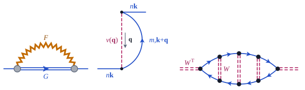

# fumadocs-feynman

<picture>
  <source media="(prefers-color-scheme: dark)" srcset=".github/assets/readme-dark.svg">
  
</picture>

Feynman diagrams for [fumadocs](https://fumadocs.dev), written in ```` ```feynman ```` code blocks the way fumadocs
uses Mermaid. They become static SVG at build time. That means no client JavaScript and no layout engine, colours
that follow the light and dark themes, and mistakes reported as build warnings that name the line.

**[Documentation](https://nevensky.github.io/fumadocs-feynman/)**: installation, a quick start, guides, the reference
and every example.

## Install

Install it from GitHub, as it is not published to npm:

```bash
npm install github:Nevensky/fumadocs-feynman --allow-git=root
```

npm 12 refuses packages from git without `--allow-git=root`, so also put `allow-git=root` in the project's `.npmrc` to
keep later installs working. Earlier versions of npm need neither. The
[installation guide](https://nevensky.github.io/fumadocs-feynman/docs/installation) has the commands for pnpm, yarn
and bun.

It needs Node 18 or later and a fumadocs site with fumadocs-mdx 11 or later. React is an optional peer: version 18 or
19 works, and with 19 the component puts its stylesheet in `<head>` by itself.

## Set up

Add the remark plugin. With fumadocs-mdx 15, in `lib/source.ts`:

```ts
import { defineDocs } from 'fumadocs-mdx/macro';
import { applyMdxPreset } from 'fumadocs-mdx/config';
import { remarkFeynman } from 'fumadocs-feynman/remark';

const docs = defineDocs({
  dir: 'content/docs',
  docs: {
    // a collection-level mdxOptions replaces the defaults, so wrap it in applyMdxPreset
    mdxOptions: applyMdxPreset({ remarkPlugins: (defaults) => [remarkFeynman, ...defaults] }),
  },
});
```

With fumadocs-mdx 11–14, add it in `source.config.ts`:
`defineConfig({ mdxOptions: { remarkPlugins: [remarkFeynman] } })`.

Then register the component, in `components/mdx.tsx`:

```tsx
import defaultMdxComponents from 'fumadocs-ui/mdx';
import { Feynman } from 'fumadocs-feynman/react';

export function getMDXComponents(components) {
  return { ...defaultMdxComponents, Feynman, ...components };
}
```

## Write a diagram

````md
```feynman
fan-migdal dressed vertex=disk
```

```feynman source
a at (0, 0) disk; b at (2.8, 0) disk
leg a left; leg b right
b -> a fermion dressed "G" below
a -- b phonon dressed bulge=1.2 above "F"
```
````

A template draws a whole diagram from one line. The language places vertices on a grid and joins them with lines.
With `source` in the fence meta, the diagram is followed by its source. When the block uses a template, the source
comes in two tabs: **Template**, as written, and **By hand**, written out vertex by vertex.

## Features

- **Templates** for the standard diagrams:
  - self-energies (Fan–Migdal, Debye–Waller, Hartree, Fock, GW and GWΓ), lying down or standing up;
  - bubbles, RPA chains and excitons;
  - ladders of any number of lines (trions, biexcitons);
  - the T matrix and the Bethe–Salpeter and parquet equations;
  - vertex corrections and GT.
- **Momentum arrows** beside interaction lines, never on them: arrowheads mark fermions only.
- **Many-body notation and colours**: electrons blue, phonons amber, photons and Coulomb lines rose.
- **Checked at build time**: an error names the file and line and suggests the fix. `strict: true` fails the build.
- **Theme-aware**: every colour is a CSS variable that follows fumadocs' light and dark themes.
- **Outside fumadocs** too: `render()` returns HTML and standalone SVG, and `expand()` writes a template out by hand.

## Development

```bash
npm test             # the renderer, the language, every example and the error reporting
npm run docs:install # the documentation site in docs/, which uses this package from the repository
npm run docs:dev     # serve the docs at http://localhost:3000
npm run docs:build   # build them (DOCS_EXPORT=1 builds a static site into docs/out)
npm run docs:gen     # regenerate the Examples pages and the template reference
```

| Path | What it is |
| --- | --- |
| `src/` | the renderer: `parse.js` (the language), `templates.js`, `expand.js` (By hand), `render.js` (SVG), `geometry.js`, `text.js` (labels), `theme.js` |
| `react/`, `remark/`, `types/`, `style.css` | the fumadocs integration and its type declarations |
| `examples/examples.js` | the examples, shared by the tests, the docs and the gallery |
| `test/run.mjs` | the tests; `test/shots.mjs` renders every example to PNG, light and dark |
| `docs/` | the documentation site (fumadocs on Next.js) |
| `gallery/build.mjs` | a static gallery of every example, with a live playground |

Nothing needs Node on the host: every command also runs in Docker, for example
`docker run --rm -v "$PWD":/work -w /work node:22-bookworm-slim npm test`. The documentation site deploys itself to
GitHub Pages on every push to `main`.

## Support

fumadocs-feynman is free and open source. If it is useful to you or your group, you can support its development on
[thanks.dev](https://thanks.dev/u/gh/nevensky).

## Citing

If you use fumadocs-feynman in published work, please cite it. The **Cite this repository** button on the
repository's GitHub page gives the reference in APA and BibTeX, from [CITATION.cff](CITATION.cff).

## Author and licence

fumadocs-feynman is written by Dr. Neven Golenić ([@Nevensky](https://github.com/Nevensky)) and released under the
[MIT License](LICENSE). Copyright © 2026 Neven Golenić.
